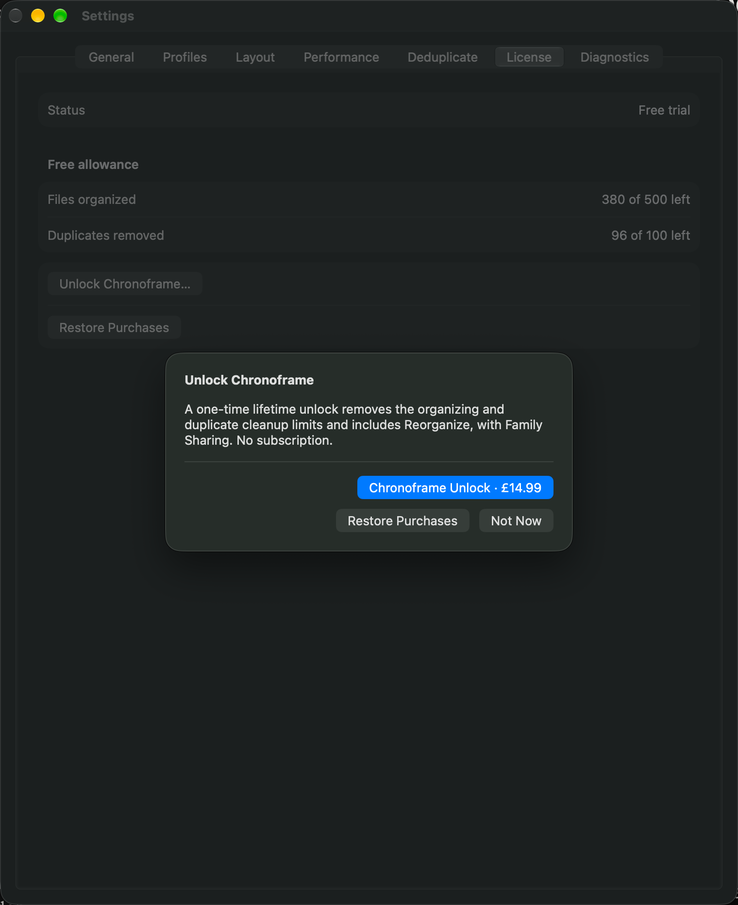

# App Review purchase discovery correction — October 19, 2026

## Status

Apple rejected app **2.0 (507)** under **2.1(b), App Completeness** on October 19:
the reviewer could not find “Chronoframe Unlock” in the binary. Review device:
MacBook Air (15-inch, M3, 2024). Submission:
`cdf1ea79-235f-4faa-8743-40ab920109f4`.

The owner authorized the focused fix, configuration verification, sandbox evidence
preparation and resubmission work. Source changes are isolated from the primary
checkout’s uncommitted design changes on `codex/direct-license-purchase`, based on
main `8c6948c`. **Build 508 is signed, exported, validated and uploaded** from
frozen source `5d1949bd1c689e4a0e83227b98573adf2301054b`; Apple accepted the upload
at 13:56:36 PDT on October 19. Apple processing completed and assigned build ID
`8863e0c2-5e20-407b-b6d1-f7d3ca253cbd`. It is Ready to Submit and available to
the existing **Internal testers** group (2 testers). Export compliance retains
build 507’s unchanged “None of the algorithms mentioned above” classification.
Physical-Mac signed sandbox purchase/restore and the requested recording remain pending.

## Findings and correction

Build 507’s License tab has Restore Purchases but no direct purchase entry. Its
purchase sheet requires an operation refusal (over allowance or locked Reorganize).
This is a concrete discovery gap; it does not prove that Apple encountered no
other StoreKit availability issue.

The replacement adds **Chronoframe → Settings… → License → Unlock Chronoframe…**.
The sheet fetches the actual product and localized price before showing the buy
button. Voluntary purchase explains the lifetime unlock without inventing a
refused run, used-up allowance or Reorganize request. Success updates License and
closes the sheet; it never starts or retries a file operation. The existing
operation-triggered sheet and free-batch flow remain available.

Purchase is offered only to confirmed non-owners in the App Store channel, even
with a full allowance or unavailable ledger. Loading/unconfirmed entitlements
lead to checking/restoration, and already-unlocked or Developer ID users are not
offered another purchase. Settings and the operation sheet observe the same
entitlement store. UI fixtures inject a fake store rather than contacting Apple.

## App Store Connect observations (read-only, October 19)

- The current submission contains two items: app **2.0 (507), Rejected** and
  **Chronoframe Unlock, Ready for Review**. The IAP itself was not shown Rejected.
- Product ID matches the binary: `com.nishith.chronoframe.unlock`.
  Apple IAP ID: `6819083459`; type: Non-Consumable.
- All 175 countries/regions selected; not removed from sale. United States current
  price is **$14.99**. Family Sharing is enabled.
- Paid Apps Agreement is **Active (New Agreement Available)**. No new terms were
  accepted. The active agreement observation is not a successful transaction test.
- The saved app/IAP notes describe the direct-free policy, but the purchase path
  depends on exceeding allowance. App notes have no recording attached. Manual
  version release is selected. No pricing, agreement, submission or product changes
  were made during this inspection.

Apple’s [sandbox review guidance](https://developer.apple.com/help/app-review/before-submitting-for-review/configure-in-app-purchases)
states that IAPs can function during review before approval. The first non-consumable
must be included with an app version in the same submission:
[submission guidance](https://developer.apple.com/help/app-store-connect/manage-submissions-to-app-review/submit-an-in-app-purchase/).

## Validation ledger

- Initial focused Swift tests: **58 passed**, covering License eligibility,
  optional-refusal purchase wording and localized price, fake purchase/restore
  propagation without starting an operation, and actual rendered price layout.
- Existing entitlement/restore, free-batch and trial-status suites: **84 passed**.
- The three new macOS UI cases pass: direct purchase before exhaustion,
  cancellation followed by explicit restore, and unavailable-product Retry/Restore.
  The existing metered License/workspace indicator case also passes.
  The purchase-sheet contrast, element detection and description audit passes
  within the modal. Its handler scopes out the inactive, dimmed Settings underlay
  (which has a separate scenario audit), and only excludes the native unlabeled
  hosting group exactly matching the sheet bounds. Every purchase control and
  unidentified audit issue remains fatal. Initial runs exposed container identifier
  propagation; explicit accessible containment preserves each button’s identifier.
- Full sharded Swift run: **1,762 tests passed**, zero failures across 31 shards.
  Meaningful coverage **95.80% (17,309/18,068 lines)**; raw coverage **71.67%**.
- Hosted UI, accessibility, SwiftPM, MAS build and other completed PR checks passed
  for the frozen source; Swift CodeQL was still pending when recorded.
- One subsequent combined local UI run failed the cancellation case after Not Now.
  The standalone rerun stalled during app launch and was stopped. No cause or
  additional passing result is inferred; prior local cases and hosted UI passes
  remain separate evidence. The signed sandbox cancellation/restore retest is still required.
- Signed universal **x86_64/arm64 Release MAS_BUILD 2.0 (508)**: archive/export,
  strict/deep signature, Apple Distribution identity, hardened runtime, sealed
  resources and app-store bundle validation pass. Minimum OS is 14.0. The installer
  has an Apple-issued 3rd Party Mac Developer Installer chain. Local Gatekeeper
  rejection of the App Store export is recorded, not bypassed or treated as an
  installed App Store result.
- Local validation package SHA-256:
  `5868b25bd9b765a68d8a159a8c29f3d6d5210581e7ea9e1aed375d82751e65d2`.
  Upload used a separate `xcodebuild -exportArchive` export from the same frozen
  archive, with `destination=upload` and automatic build-number changes disabled.
  This hash identifies the locally validated package, not the upload’s re-export.
  Archive, packages and logs are in `.tmp/release-508/` and `.tmp/logs/` in the
  isolated checkout; `release-artifacts/2.0-508/release-record.json` is local evidence.
- Actual sandbox transaction, signed cancellation/explicit restore and physical-Mac
  recording: pending. Local fake transactions never count as sandbox/production evidence.

Native Settings-window capture from a passing UI fixture (simulated product/price,
not a sandbox transaction or Apple submission attachment):

## Physical-Mac evidence session

Use the replacement installed through TestFlight on a real Mac, a sandbox test
account and disposable source/destination folders. Preserve existing owner settings,
bookmarks, allowance records and purchases. Use a fresh sandbox account for a new
purchase; reinstalling does not reset allowance or purchase ownership.

1. Start a screen recording from the Mac desktop, launch Chronoframe and show
   About’s actual version/build. Record the account’s storefront, without showing
   credentials or personal media.
2. Demonstrate choosing separate folders, Preview Plan, approving a small verified
   copy and inspecting History. Show duplicate review/Trash/recovery on disposable
   copies if demonstrating those core flows; do not empty Trash.
3. Open Settings → License with free allowance still remaining. Click
   Unlock Chronoframe… and show the product’s localized price and Restore Purchases.
   Cancel one Apple sandbox purchase and confirm access/allowance is unchanged.
4. Complete a new **sandbox** purchase. Capture Apple’s sandbox success and License
   becoming Unlocked, then quit/relaunch and confirm the verified unlock persists.
5. Exercise **Restore Purchases explicitly**, using a signed test installation that
   has not already recovered ownership automatically. If launch recovery already
   shows Unlocked, record that separately; it is not a button-driven restore test.
   Do not reset the owner’s ledger or entitlement to force the screen.
6. Demonstrate the other purchase entrances (an over-allowance operation and locked
   Reorganize) with a separate unowned sandbox state as needed. They use the same
   single product; there is no subscription, second SKU or Chronoframe login.

Record actual results, build/source/package identities and recording path before
claiming completion. Have the owner confirm any remaining signed release gates.

## Fresh sandbox account handoff

The owner needs help preparing a fresh account; it is not yet created. Open
App Store Connect → Users and Access → Sandbox → add test account. The owner
chooses an email address never registered as an Apple Account (a unique plus
alias is supported when the email provider supports it), enters a new strong
password and completes creation personally. Use United States for the $14.99
US recording. Do not put the account password in this repository or the recording.
Do not clear an existing account’s purchase history to manufacture a fresh purchase.

Apple’s [account creation instructions](https://developer.apple.com/help/app-store-connect/test-in-app-purchases/create-a-sandbox-apple-account/)
describe the fields and email restrictions. Its
[sandbox testing documentation](https://developer.apple.com/documentation/storekit/testing-in-app-purchases-with-sandbox)
places the macOS sandbox sign-in in App Store → Settings after an initial purchase
attempt. Inspect the actual Mac UI before changing sign-in state; the documented
TestFlight Developer-settings walkthrough is for iOS and must not be assumed to
apply to macOS. Creating an account alone is not proof that TestFlight is using it.
Verify the actual purchasing identity/environment and locked entitlement before
recording a new transaction.

## Resubmission preparation

The exact purchase navigation is prepared in `docs/APP_STORE_METADATA.md`.
After the signed checks and recording are complete, select the validated replacement
build, update the app and IAP review notes, replace the IAP review screenshot with
the real signed purchase screen, and attach the requested physical-Mac recording
in App Review Information. Keep Chronoframe Unlock and the app together in the
submission; retain manual release. Public app Free pricing remains coordinated
with approved V2 release, not changed as part of this code correction.

Draft reply — send only after the replacement and real recording are attached:

> Thank you. We have added a direct purchase entry at Chronoframe → Settings… →
> License → Unlock Chronoframe…. The sheet displays Chronoframe Unlock
> (com.nishith.chronoframe.unlock) and the localized App Store price. Reviewers do
> not need to exhaust the free allowance or configure a library to reach it.
> Restore Purchases is available from License and the purchase sheet while locked.
> No Chronoframe sign-in or demo account is required. The replacement build and
> attached physical-Mac recording demonstrate the sandbox purchase and access flow.

Do not send this draft with placeholders or infer a completed restore from automatic
entitlement recovery. Record the tested build and recording filename alongside it.
