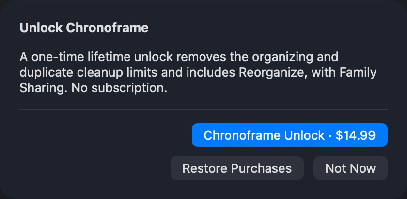
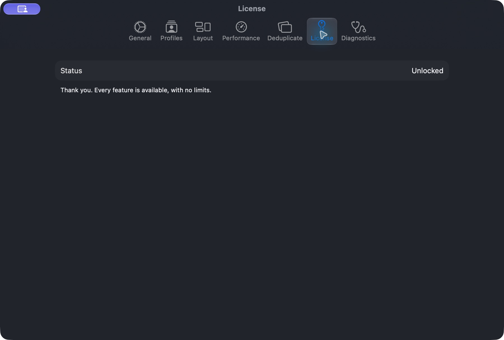

# App Review purchase discovery correction — October 19, 2026

## Status

Apple rejected app **2.0 (507)** under **2.1(b), App Completeness** on October 19:
the reviewer could not find “Chronoframe Unlock” in the binary. Review device:
MacBook Air (15-inch, M3, 2024). Submission:
`cdf1ea79-235f-4faa-8743-40ab920109f4`.

The owner authorized the focused fix, configuration verification, sandbox evidence
preparation and resubmission work. Source changes are isolated from the primary
checkout’s uncommitted design changes on `codex/direct-license-purchase`, based on
main `8c6948c`. **Build 508 is signed, exported, validated and uploaded** from
frozen source `5d1949bd1c689e4a0e83227b98573adf2301054b`; Apple accepted the upload
at 13:56:36 PDT on October 19. Apple processing completed and assigned build ID
`8863e0c2-5e20-407b-b6d1-f7d3ca253cbd`. It is Ready to Submit and available to
the existing **Internal testers** group (2 testers). Export compliance retains
build 507’s unchanged “None of the algorithms mentioned above” classification.
The fresh-account physical-Mac sandbox purchase **passed on TestFlight 508** at
approximately 21:06 PDT. Apple displayed purchase success, License became
**Unlocked**, and the unlock persisted after quit/relaunch. The owner retried
without restarting; no authentication reset or shipping-code change was needed.
Explicit Restore Purchases and the requested completed recording remain pending.

## Findings and correction

Build 507’s License tab has Restore Purchases but no direct purchase entry. Its
purchase sheet requires an operation refusal (over allowance or locked Reorganize).
This is a concrete discovery gap; it does not prove that Apple encountered no
other StoreKit availability issue.

The replacement adds **Chronoframe → Settings… → License → Unlock Chronoframe…**.
The sheet fetches the actual product and localized price before showing the buy
button. Voluntary purchase explains the lifetime unlock without inventing a
refused run, used-up allowance or Reorganize request. Success updates License and
closes the sheet; it never starts or retries a file operation. The existing
operation-triggered sheet and free-batch flow remain available.

Purchase is offered only to confirmed non-owners in the App Store channel, even
with a full allowance or unavailable ledger. Loading/unconfirmed entitlements
lead to checking/restoration, and already-unlocked or Developer ID users are not
offered another purchase. Settings and the operation sheet observe the same
entitlement store. UI fixtures inject a fake store rather than contacting Apple.

## App Store Connect observations (read-only, October 19)

- The current submission contains two items: app **2.0 (507), Rejected** and
  **Chronoframe Unlock, Ready for Review**. The IAP itself was not shown Rejected.
- Product ID matches the binary: `com.nishith.chronoframe.unlock`.
  Apple IAP ID: `6819083459`; type: Non-Consumable.
- All 175 countries/regions selected; not removed from sale. United States current
  price is **$14.99**. Family Sharing is enabled.
- Paid Apps Agreement is **Active (New Agreement Available)**. No new terms were
  accepted. The active agreement observation is not a successful transaction test.
- The saved app/IAP notes describe the direct-free policy, but the purchase path
  depends on exceeding allowance. App notes have no recording attached. Manual
  version release is selected. No pricing, agreement, submission or product changes
  were made during this inspection.

Apple’s [sandbox review guidance](https://developer.apple.com/help/app-review/before-submitting-for-review/configure-in-app-purchases)
states that IAPs can function during review before approval. The first non-consumable
must be included with an app version in the same submission:
[submission guidance](https://developer.apple.com/help/app-store-connect/manage-submissions-to-app-review/submit-an-in-app-purchase/).

## Validation ledger

- Initial focused Swift tests: **58 passed**, covering License eligibility,
  optional-refusal purchase wording and localized price, fake purchase/restore
  propagation without starting an operation, and actual rendered price layout.
- Existing entitlement/restore, free-batch and trial-status suites: **84 passed**.
- The three new macOS UI cases pass: direct purchase before exhaustion,
  cancellation followed by explicit restore, and unavailable-product Retry/Restore.
  The existing metered License/workspace indicator case also passes.
  The purchase-sheet contrast, element detection and description audit passes
  within the modal. Its handler scopes out the inactive, dimmed Settings underlay
  (which has a separate scenario audit), and only excludes the native unlabeled
  hosting group exactly matching the sheet bounds. Every purchase control and
  unidentified audit issue remains fatal. Initial runs exposed container identifier
  propagation; explicit accessible containment preserves each button’s identifier.
- Full sharded Swift run: **1,762 tests passed**, zero failures across 31 shards.
  Meaningful coverage **95.80% (17,309/18,068 lines)**; raw coverage **71.67%**.
- Hosted UI, accessibility, SwiftPM, MAS build and other completed PR checks passed
  for the frozen source. All hosted checks, including Swift analysis and CodeQL,
  subsequently passed at evidence-only commit `29e8226`.
- One subsequent combined local UI run failed the cancellation case after Not Now.
  The standalone rerun stalled during app launch and was stopped. No cause or
  additional passing result is inferred; prior local cases and hosted UI passes
  remain separate evidence. Signed sandbox cancellation is now verified; explicit
  restore remains required.
- Signed universal **x86_64/arm64 Release MAS_BUILD 2.0 (508)**: archive/export,
  strict/deep signature, Apple Distribution identity, hardened runtime, sealed
  resources and app-store bundle validation pass. Minimum OS is 14.0. The installer
  has an Apple-issued 3rd Party Mac Developer Installer chain. Local Gatekeeper
  rejection of the App Store export is recorded, not bypassed or treated as an
  installed App Store result.
- Local validation package SHA-256:
  `5868b25bd9b765a68d8a159a8c29f3d6d5210581e7ea9e1aed375d82751e65d2`.
  Upload used a separate `xcodebuild -exportArchive` export from the same frozen
  archive, with `destination=upload` and automatic build-number changes disabled.
  This hash identifies the locally validated package, not the upload’s re-export.
  Archive, packages and logs are in `.tmp/release-508/` and `.tmp/logs/` in the
  isolated checkout; `release-artifacts/2.0-508/release-record.json` is local evidence.
- Actual fresh-account sandbox transaction, signed cancellation and unlock after
  relaunch: **passed on TestFlight 508**. Explicit Restore Purchases and the
  completed physical-Mac purchase recording remain pending. Local fake transactions
  never count as sandbox/production evidence.

Native Settings-window capture from a passing UI fixture (simulated product/price,
not a sandbox transaction or Apple submission attachment):

## Physical-Mac evidence session

Use the replacement installed through TestFlight on a real Mac, a sandbox test
account and disposable source/destination folders. Preserve existing owner settings,
bookmarks, allowance records and purchases. Use a fresh sandbox account for a new
purchase; reinstalling does not reset allowance or purchase ownership.

1. Start a screen recording from the Mac desktop, launch Chronoframe and show
   About’s actual version/build. Record the account’s storefront, without showing
   credentials or personal media.
2. Demonstrate choosing separate folders, Preview Plan, approving a small verified
   copy and inspecting History. Show duplicate review/Trash/recovery on disposable
   copies if demonstrating those core flows; do not empty Trash.
3. Open Settings → License with free allowance still remaining. Click
   Unlock Chronoframe… and show the product’s localized price and Restore Purchases.
   Cancel one Apple sandbox purchase and confirm access/allowance is unchanged.
4. Complete a new **sandbox** purchase. Capture Apple’s sandbox success and License
   becoming Unlocked, then quit/relaunch and confirm the verified unlock persists.
5. Exercise **Restore Purchases explicitly**, using a signed test installation that
   has not already recovered ownership automatically. If launch recovery already
   shows Unlocked, record that separately; it is not a button-driven restore test.
   Do not reset the owner’s ledger or entitlement to force the screen.
6. Demonstrate the other purchase entrances (an over-allowance operation and locked
   Reorganize) with a separate unowned sandbox state as needed. They use the same
   single product; there is no subscription, second SKU or Chronoframe login.

Record actual results, build/source/package identities and recording path before
claiming completion. Have the owner confirm any remaining signed release gates.

## Fresh sandbox account handoff

The owner reports creating the fresh sandbox tester on October 19. Its prepared
form used a test name and the United States storefront; the owner supplied the
email and password and completed creation personally. No credentials are recorded
here. Build 508 was installed through TestFlight, and the installed Info.plist
confirms 2.0 (508) with an App Store receipt present. Before switching purchase
accounts, License showed Unlocked from earlier testing.

The owner explicitly authorized signing out of **Media & Purchases** on this Mac.
System Settings then showed “No media accounts found”; the main iCloud account
remained signed in. No allowance records, purchases, preferences or bookmarks were
reset. On relaunch, License showed “Checking your purchase…” and an explicit
Restore Purchases request was started to reach Apple’s account prompt. Signing
into the new sandbox identity and a real purchase remain unverified.

A separate Apple Development-signed Debug `MAS_BUILD` was compiled from the same
app source to initialize sandbox sign-in (no Xcode StoreKit configuration and no
fake entitlement injected). It lives in `.tmp/SandboxSignInDerivedData/`, separate
from the installed TestFlight app. Initial authentication stalled; the StoreKit
helper was restarted, and the Apple `storeuid` dialog was located through native
UI inspection. A fresh development-build Restore request logs **Sandbox
authentication** with no active sandbox account. The generic Apple Account dialog
prefilled the personal email; it was cleared for the owner to enter the newly
created sandbox tester. No credential was entered by the agent. This is an
authentication handoff, **not a completed restore or purchase**. After sign-in,
return to `/Applications/Chronoframe.app` (TestFlight 508), confirm the actual
identity/locked state and complete the recording.

The signed-out TestFlight attempt stayed at Checking your purchase and Restore
reported it could not reach the App Store after authentication failed. StoreKit
logged no active account and authentication cancellation. This is observed
negative-state evidence; it does not establish a product-availability failure or
a successfully completed fresh-account test. Do not put the account password in
this repository or the recording.
Do not clear an existing account’s purchase history to manufacture a fresh purchase.

Apple’s [account creation instructions](https://developer.apple.com/help/app-store-connect/test-in-app-purchases/create-a-sandbox-apple-account/)
describe the fields and email restrictions. Its
[sandbox testing documentation](https://developer.apple.com/documentation/storekit/testing-in-app-purchases-with-sandbox)
places the macOS sandbox sign-in in App Store → Settings after an initial purchase
attempt. Inspect the actual Mac UI before changing sign-in state; the documented
TestFlight Developer-settings walkthrough is for iOS and must not be assumed to
apply to macOS. Creating an account alone is not proof that TestFlight is using it.
Verify the actual purchasing identity/environment and locked entitlement before
recording a new transaction.

## Fresh-account signed product verification — October 19

The owner completed sandbox sign-in. StoreKit subsequently logged a sandbox
account change, successful transaction synchronization and **0 transactions**.
The installed TestFlight **2.0 (508)** then resolved to **Free trial**, with
**500 of 500** organized files and **100 of 100** duplicate removals remaining.
Settings → License → Unlock Chronoframe… loaded the real product as
**Chronoframe Unlock · $14.99**, with Restore Purchases and Not Now available.
Not Now closed the sheet; no purchase was attempted and the fresh-account state
was preserved for recording. This establishes signed product discovery, not a
completed purchase, Apple purchase-dialog cancellation or explicit restore.

Native recording launch was attempted through Screenshot, the standard macOS
shortcut and QuickTime’s New Screen Recording, but the recording toolbar could
not be controlled reliably through this computer-use session. The owner must
start the physical-Mac recording locally before the fresh purchase is consumed.
No recording file or completed transaction is claimed.

Disposable demo folders are prepared under `/private/tmp/Chronoframe-Review-508/`:
`Review 508 Source` contains one copy of the repository’s 128×128 PNG fixture;
`Review 508 Destination` starts empty; `Review 508 Duplicates` holds two identical
fixture copies for a separate dedupe demonstration if needed. The app’s manual
source/destination were changed to the first two folders through native pickers.
At preparation time no transfer had run. The prior `bulk10k` source and `507-photos-check` destination
and their contents/receipts are retained. A source SHA-256 manifest is saved locally
at `.tmp/release-508/demo-source-sha256.json`.

## Signed recording session — purchase confirmation blocked

The owner started a physical-Mac recording. On the installed TestFlight **2.0
(508)**, the session showed About, selected the disposable folders, previewed one
file, approved the transfer and inspected its History receipt. The run completed
at **17:38:50 PDT on October 19** with **1 copied, 0 failures**, verification on.
History's explicit verification showed **Match**. The completed receipt is
`audit_receipt_20261019_173850_E1E61E9E-89F6-4279-AC38-B8F53219A4B3.json` in the
demo destination's `.organize_logs/`. Source and destination SHA-256 both remain
`2d2d1cf9c3f82ece67afbcf5e0cea55d12553b20e1c144e6ffd6c4f15a6157d2`.
License then showed **499 of 500** organize and **100 of 100** dedupe remaining.

Direct License purchase reached Apple's real $14.99 sandbox sheet, including the
explicit no-charge testing notice. Cancelling returned to the same free-trial
balance. A changed-layout Reorganize attempt also reached the unlock sheet before
mutation; it was dismissed and the layout preference restored to `YYYY/MM/DD`.
The separate duplicate demo has not been executed.

Apple's final purchase sheet repeatedly rendered only Cancel, with a blank footer.
Two local development-build presentation experiments (explicit NSWindow and
SwiftUI PurchaseAction) did not establish a correction and were removed from the
source; neither was uploaded. The active installed candidate remains unchanged
TestFlight 508. A locally initiated mouse attempt also produced the incomplete
sheet in the owner's supplied screenshot. A preceding owner reply said
Buy/Confirm appeared, but the subsequent screenshot does not show it; do not count
that reply as a completed transaction or a proven automation-only problem.
Native accessibility inspection briefly exposed a **Purchase** button (`footer`)
even though it was not visibly rendered. After the owner started a new recording,
that control was absent. Raising the sheet and checking keyboard focus did not
restore it. A fresh cancellation/retry again exposed only Cancel, so Purchase was
not invoked. Both sheets were cancelled and the app returned to License with
499/500 and 100/100 remaining. The Mac reports macOS 27.0.1 (26A434).
StoreKit-related logs also reported a biometric accessory not paired error;
this is diagnostic context, not a proven cause. A local check with recording and
computer control inactive is still pending; do not assert either is the cause.

The owner supplied the saved Desktop recording `Screen Recording 2026-10-19 at
5.59.08 PM.mov` (the actual filename uses a narrow no-break space before PM).
The file is **124,387,586 bytes**, H.264, **3840×2160**, **175.992 seconds**;
SHA-256 is `90bbf09faa239044c0229b199584b561e022796c36bed27176b09c1ba840a3df`.
Sampled frames show the incomplete Apple sheet and a return to Free trial; this
clip does not establish the earlier organize run or a completed purchase. It also
includes unrelated desktop/chat/browser content, so retain it locally as
diagnostic evidence rather than attaching it as the completed App Review demo.
The exact local path is recorded in the ignored release ledger.

At this stage no successful transaction, persisted unlock or explicit restore was
verified. The later successful retry is recorded below. Keep account-bearing Apple
screenshots local and distinguish the diagnostic clip from completed review proof.

## Authentication loop after the confirmation button returned

With recording stopped, the owner supplied a screenshot showing Apple's blue
Purchase button and no-charge sandbox notice. At approximately **21:03 PDT**, the
owner then reported that Buy repeatedly reopened a **Sign In to the App Store**
dialog containing only Cancel and Buy, with no credential fields.

Logs show Apple's payment sheet was authorized at 21:03:39, followed by repeated
failures **within the same purchase correlation**: `AMSAnisette` could not generate
type-1 authentication headers (**-45061**), and Mescal header generation reported
`AMSErrorDomain` **204**. These observations point to an Apple authentication
session problem; they do not establish the underlying cause or a completed sale.
Source inspection confirms a single `Product.purchase()` call, protected against
overlapping purchase/restore requests, with no automatic purchase retry loop.

The stalled request closed and License returned to Free trial with **499/500**
and **100/100** remaining. A redacted diagnostic extract is retained locally in
`.tmp/release-508/auth-loop-diagnostic-redacted.log`. A Mac restart followed by a
local TestFlight retry is pending. No account, purchase history, allowance ledger,
bookmark, keychain or authentication cache was reset. Purchase, relaunch, explicit
restore and the completed App Review recording remain open.

## Successful sandbox purchase and relaunch — approximately 21:06 PDT

The owner retried **without restarting the Mac** and supplied Apple's **“Your
purchase was successful”** confirmation. Native UI inspection independently
confirmed the same success message. After dismissing it, the voluntary unlock
sheet closed and Settings → License showed **Unlocked**, with “Every feature is
available, with no limits.” No file operation was started by purchase completion.

The agent quit Chronoframe, relaunched `/Applications/Chronoframe.app`, reopened
Settings → License and verified **Unlocked** again. The installed Info.plist still
reports `com.nishith.chronoframe`, **2.0 (508)**, and its App Store receipt is
present. This is the unchanged TestFlight candidate built from frozen source
`5d1949b`, not either local presentation experiment. The previously unowned sandbox
account now owns the unlock; do not clear its purchase history to repeat a new sale.

This passes the real sandbox purchase and persisted-unlock gates. The prior
authentication failure was transient in this session; its underlying cause and
the effect of screen capture are not proven by the successful retry. The proposed
Mac restart was not performed, and no account/cache/keychain reset was needed.

The owner confirmed the successful purchase **was not recorded**. Its Apple
success screenshot and independently verified persisted unlock remain valid
functional evidence, but the requested purchase recording is missing. The saved
175.992-second desktop diagnostic clip does not capture the successful transaction.

**Still pending:** explicit button-driven Restore Purchases (automatic recovery on
relaunch does not satisfy that gate) and the complete recording Apple requested.
A second fresh tester is being prepared for a recorded new purchase without
resetting the first tester's ownership. The New Tester form has test name
Chronoframe Recording508 and US storefront populated; the owner must supply new
credentials and complete creation locally. This is a prepared form, not a created
account. See [the capture checklist](app-review-iap-rejection-2026-10-19/recording-checklist.md).

## Resubmission preparation

The exact purchase navigation is prepared in `docs/APP_STORE_METADATA.md`.
After the signed checks and recording are complete, select the validated replacement
build, update the app and IAP review notes, replace the IAP review screenshot with
the real signed purchase screen, and attach the requested physical-Mac recording
in App Review Information. Keep Chronoframe Unlock and the app together in the
submission; retain manual release. Public app Free pricing remains coordinated
with approved V2 release, not changed as part of this code correction.

Draft reply — send only after the replacement and real recording are attached:

> Thank you. We have added a direct purchase entry at Chronoframe → Settings… →
> License → Unlock Chronoframe…. The sheet displays Chronoframe Unlock
> (com.nishith.chronoframe.unlock) and the localized App Store price. Reviewers do
> not need to exhaust the free allowance or configure a library to reach it.
> Restore Purchases is available from License and the purchase sheet while locked.
> No Chronoframe sign-in or demo account is required. The replacement build and
> attached physical-Mac recording demonstrate the sandbox purchase and access flow.

Do not send this draft with placeholders or infer a completed restore from automatic
entitlement recovery. Record the tested build and recording filename alongside it.
