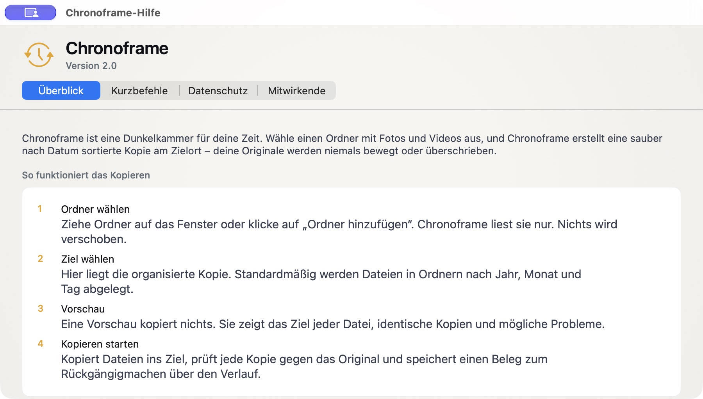

# German localization verification — 2026-11-15

German catalogs and runtime lookup paths are complete for the current extracted keys. The visual pass found additional gaps and text-fitting problems, which were repaired. **A full visual sign-off remains incomplete because the computer-use connection timed out repeatedly.**

## Automated evidence

- PR preparation: exported committed snapshot `c7f2fd0` after integrating `origin/main`, excluding unrelated working-file edits. `xcodebuild` against `.tmp/german-pr-check/ui/Chronoframe.xcodeproj` — `BUILD SUCCEEDED` (`/private/tmp/chronoframe-german-pr-build.log`). `swift test --package-path .tmp/german-pr-check/ui --scratch-path .tmp/german-pr-build --disable-sandbox --filter 'ChronoframeAppTests|GermanLocalizationTests|ChronoframeCoreLibraryHealthScannerTests|RunPhaseDisplayTests|LicenseStatusPresentationTests|TrialIndicatorPresentationTests|UnlockPresentationTests|RunSessionStoreTests|PhotosImportStoreTests|EntitlementStoreTests|HistoryStoreTests|UserFacingErrorMessageTests'` — **667 passed, zero failures** (463 App, 204 AppCore); log `/private/tmp/chronoframe-german-pr-tests.log`. The portable catalog check also passed against this snapshot and its extracted keys.
- `xcodebuild -project ui/Chronoframe.xcodeproj -scheme Chronoframe -configuration Debug -derivedDataPath .tmp/ChronoframeDerivedData -destination 'platform=macOS,arch=arm64' CODE_SIGNING_ALLOWED=NO SWIFT_EMIT_LOC_STRINGS=YES build` — `BUILD SUCCEEDED`; log `/private/tmp/chronoframe-german-ui-build.log`.
- Broad presentation/localization regression command: `swift test --package-path ui --disable-sandbox --filter 'ChronoframeAppTests|GermanLocalizationTests|ChronoframeCoreLibraryHealthScannerTests|RunPhaseDisplayTests|LicenseStatusPresentationTests|TrialIndicatorPresentationTests|UnlockPresentationTests|RunSessionStoreTests|PhotosImportStoreTests|EntitlementStoreTests'` — **635 tests passed, zero failures** (460 App, 175 AppCore); output `/private/tmp/chronoframe-german-tests.log`.
- Current focused command: `swift test --package-path ui --disable-sandbox --filter 'GermanLocalizationTests|DeduplicateAccessibilityTextTests|DeduplicateReviewViewsTests|DeduplicateReviewLanesTests|LibraryHealthCopyTests|ChronoframeCoreLibraryHealthScannerTests|RunPreviewHeadlineTests'` — **85 tests passed**, zero failures; output `/private/tmp/chronoframe-german-final-tests.log`.
- `xcrun xcstringstool compile` for both catalogs — exit 0. `python3 script/check_german_localization.py --baseline-ref 8ae71cf --stringsdata-directory .tmp/ChronoframeDerivedData/Build/Intermediates.noindex/Chronoframe.build/Debug/ChronoframeApp.build/Objects-normal/arm64` — **1,630 App / 298 Core German strings verified**, including placeholder types/positions, actual compiled values, original keys/metadata and other locales. **880 App / 257 AppCore extracted keys, zero missing German entries.**
- `plutil -lint ui/Sources/ChronoframeApp/Resources/de.lproj/InfoPlist.strings` and `git diff --check` — exit 0. Photos read-only, navigation-title, reduced-motion and invariant-tag guards passed during this task. These are separate from a complete UI/accessibility audit.

## UI steps and findings

| Step | Surface | Observed result / limit |
| --- | --- | --- |
| 1 | Organize setup | German hero, instructions, layout choices, native folder buttons and help. Fixed plain-String/AppKit lookup bypasses. |
| 2 | Preview & Copy, idle | German summary and onboarding. Fixed dynamic count/phase/progress phrases and spoken onboarding text. Populated preview remains unverified visually. |
| 3 | Watched folders and Health | Inspected initial states and identified cross-table/dynamic-message gaps. Corrected lookup coverage and added typed Health message data; German dynamic output verified by tests. Final Health screenshot not recaptured. |
| 4 | General settings | German text; no clipping observed at the 760-point settings width. |
| 5 | Performance settings | German presets, dynamic worker counts, controls and explanatory text; no clipping observed. |
| 6 | Layout settings | German controls and safety explanation; no mutation initiated. |
| 7 | License settings | German non-App-Store state inspected. App Store allowance/purchase sheet remains visually unverified. |
| 8 | Deduplicate settings | German preset labels, pairing controls and review-only video explanation; no setting changed. |
| 9 | Diagnostics settings | German controls and explanatory text; supplied technical terminology retained. |
| 10 | Profiles settings | German copy inspected. Widened the current-path label column after observing a broken word; final fit recheck blocked. |
| 11 | Help overview | German workflow/safety copy; actual on-disk names remain verbatim. |
| 12 | Help shortcuts | German command descriptions and labels; shortcut symbols unchanged. |
| 13 | Help privacy / acknowledgments | German text and spoken reveal labels; paths, framework names and URLs unchanged. |
| 14 | Populated duplicate review | Captured German list, safeguards, footer, buttons and allowance at 900×700 points. Fixed English dynamic safeguard text, raw kind/role names, score tooltips, and inspector text fit. Final compact capture accepted; final wide inspector recheck blocked. No Trash action initiated. |
| 15 | Photos / populated History / purchase sheet | **Blocked by UI connection failures before visual inspection.** Resource, formatter and existing regression checks passed; do not treat those as screenshots. |

## Accepted examples

The screenshots below are exact native captures from this run. Some other files in the capture folder record pre-fix findings and are not final evidence.

### German performance settings

### German Help

### Compact duplicate review

## Next verification

Reconnect computer use and inspect the isolated copied app with the existing `photosImport`, `historyPopulated`, `runPreviewReview`, `settingsLicense` and `deduplicateReviewWide` scenarios. Recheck the final Profiles label width and inspector quality/reason-heading fitting. Use synthetic media; no real import, Trash operation or purchase is needed.
