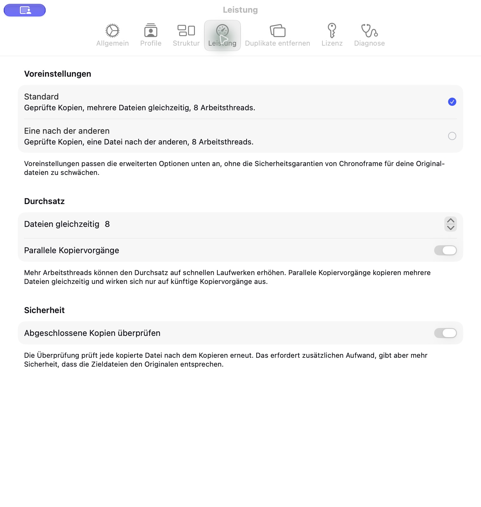
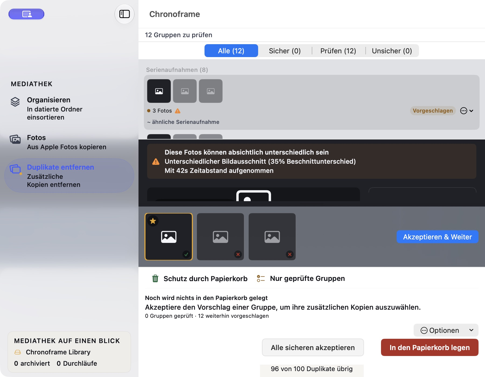

# German localization verification — 2026-11-15

German catalogs and runtime lookup paths are complete for the current extracted keys. The visual pass found additional gaps and text-fitting problems, which were repaired. **A full visual sign-off remains incomplete because the computer-use connection timed out repeatedly.**

## Automated evidence

- PR preparation: exported committed snapshot `c7f2fd0` after integrating `origin/main`, excluding unrelated working-file edits. `xcodebuild` against `.tmp/german-pr-check/ui/Chronoframe.xcodeproj` — `BUILD SUCCEEDED` (`/private/tmp/chronoframe-german-pr-build.log`). `swift test --package-path .tmp/german-pr-check/ui --scratch-path .tmp/german-pr-build --disable-sandbox --filter 'ChronoframeAppTests|GermanLocalizationTests|ChronoframeCoreLibraryHealthScannerTests|RunPhaseDisplayTests|LicenseStatusPresentationTests|TrialIndicatorPresentationTests|UnlockPresentationTests|RunSessionStoreTests|PhotosImportStoreTests|EntitlementStoreTests|HistoryStoreTests|UserFacingErrorMessageTests'` — **667 passed, zero failures** (463 App, 204 AppCore); log `/private/tmp/chronoframe-german-pr-tests.log`. The portable catalog check also passed against this snapshot and its extracted keys.
- `xcodebuild -project ui/Chronoframe.xcodeproj -scheme Chronoframe -configuration Debug -derivedDataPath .tmp/ChronoframeDerivedData -destination 'platform=macOS,arch=arm64' CODE_SIGNING_ALLOWED=NO SWIFT_EMIT_LOC_STRINGS=YES build` — `BUILD SUCCEEDED`; log `/private/tmp/chronoframe-german-ui-build.log`.
- Broad presentation/localization regression command: `swift test --package-path ui --disable-sandbox --filter 'ChronoframeAppTests|GermanLocalizationTests|ChronoframeCoreLibraryHealthScannerTests|RunPhaseDisplayTests|LicenseStatusPresentationTests|TrialIndicatorPresentationTests|UnlockPresentationTests|RunSessionStoreTests|PhotosImportStoreTests|EntitlementStoreTests'` — **635 tests passed, zero failures** (460 App, 175 AppCore); output `/private/tmp/chronoframe-german-tests.log`.
- Current focused command: `swift test --package-path ui --disable-sandbox --filter 'GermanLocalizationTests|DeduplicateAccessibilityTextTests|DeduplicateReviewViewsTests|DeduplicateReviewLanesTests|LibraryHealthCopyTests|ChronoframeCoreLibraryHealthScannerTests|RunPreviewHeadlineTests'` — **85 tests passed**, zero failures; output `/private/tmp/chronoframe-german-final-tests.log`.
- `xcrun xcstringstool compile` for both catalogs — exit 0. `python3 script/check_german_localization.py --baseline-ref 8ae71cf --stringsdata-directory .tmp/ChronoframeDerivedData/Build/Intermediates.noindex/Chronoframe.build/Debug/ChronoframeApp.build/Objects-normal/arm64` — **1,630 App / 298 Core German strings verified**, including placeholder types/positions, actual compiled values, original keys/metadata and other locales. **880 App / 257 AppCore extracted keys, zero missing German entries.**
- `plutil -lint ui/Sources/ChronoframeApp/Resources/de.lproj/InfoPlist.strings` and `git diff --check` — exit 0. Photos read-only, navigation-title, reduced-motion and invariant-tag guards passed during this task. These are separate from a complete UI/accessibility audit.

## UI steps and findings

| Step | Surface | Observed result / limit |
| --- | --- | --- |
| 1 | Organize setup | German hero, instructions, layout choices, native folder buttons and help. Fixed plain-String/AppKit lookup bypasses. |
| 2 | Preview & Copy, idle | German summary and onboarding. Fixed dynamic count/phase/progress phrases and spoken onboarding text. Populated preview remains unverified visually. |
| 3 | Watched folders and Health | Inspected initial states and identified cross-table/dynamic-message gaps. Corrected lookup coverage and added typed Health message data; German dynamic output verified by tests. Final Health screenshot not recaptured. |
| 4 | General settings | German text; no clipping observed at the 760-point settings width. |
| 5 | Performance settings | German presets, dynamic worker counts, controls and explanatory text; no clipping observed. |
| 6 | Layout settings | German controls and safety explanation; no mutation initiated. |
| 7 | License settings | German non-App-Store state inspected. App Store allowance/purchase sheet remains visually unverified. |
| 8 | Deduplicate settings | German preset labels, pairing controls and review-only video explanation; no setting changed. |
| 9 | Diagnostics settings | German controls and explanatory text; supplied technical terminology retained. |
| 10 | Profiles settings | German copy inspected. Widened the current-path label column after observing a broken word; final fit recheck blocked. |
| 11 | Help overview | German workflow/safety copy; actual on-disk names remain verbatim. |
| 12 | Help shortcuts | German command descriptions and labels; shortcut symbols unchanged. |
| 13 | Help privacy / acknowledgments | German text and spoken reveal labels; paths, framework names and URLs unchanged. |
| 14 | Populated duplicate review | Captured German list, safeguards, footer, buttons and allowance at 900×700 points. Fixed English dynamic safeguard text, raw kind/role names, score tooltips, and inspector text fit. Final compact capture accepted; final wide inspector recheck blocked. No Trash action initiated. |
| 15 | Photos import | 2026-11-21 capture (`20`, `21`): German header, selection, button and the unreadable-selection alert. The English "All Photos" album title is the UI-test fixture (`UITestAppStateFactory`); production uses `CoreL10n`. |
| 16 | Populated History | Captures `22`/`23`: German throughout. **Found:** the report filter's last segment ("Sonstige") clipped at the 320 pt cap. Fixed (cap 440 pt); recapture `29` confirms all segments fit. |
| 17 | Populated Preview & Copy | Captures `24`/`25`: German. **Found:** the metrics ticker showed "ALREADY THERE" (no catalog key for the lowercase plain-string label). Fixed by adding `already there` → "bereits vorhanden"; recapture `30` confirms "BEREITS VORHANDEN". Prüfen, Probleme and Aktivität tabs not opened. |
| 18 | License allowance and unlock sheet | Captures `26`/`27`: German allowance and "Chronoframe freischalten" sheet. The price button text is the fixture product. Dismissed with "Nicht jetzt"; no purchase. |
| 19 | Wide duplicate review | Capture `28`: German; the quality row fits ("Qualität / Ausgezeichnet"). |

## Accepted examples

The screenshots below are exact native captures from this run. Some other files in the capture folder record pre-fix findings and are not final evidence.

### German performance settings

### German Help

### Compact duplicate review

## 2026-11-21 follow-up

Driven through the isolated `ChronoframeGermanCheck.app` with the `photosImport`, `historyPopulated`, `runPreviewReview`, `settingsLicense` and `deduplicateReviewWide` scenarios (synthetic data; no real library, Trash action or purchase). Captures `20`–`28` are in the gitignored `.tmp/german-ui-check/screenshots/`.

Two defects were fixed after the pass:
- `already there` ticker label: new catalog key. `GermanLocalizationTests.testRunTickerLabelsResolveInGerman` failed before the key and passes after.
- History filter clipping: `RunHistoryView` filter `maxWidth` 320 → 440. This is a layout change with no unit test.

Verified: `swift test --filter 'GermanLocalizationTests|RunHistoryView|HistoryStoreTests|AccessibilityTests'` — 0 failures; the catalog JSON loads.

Visual recheck (same day): rebuilt with `xcodebuild … -derivedDataPath .tmp/ChronoframeDerivedData` (`BUILD SUCCEEDED`), swapped the binary and `de`/`en.lproj` into `ChronoframeGermanCheck.app`, re-signed ad hoc, relaunched.
- History (`29-history-filter-fixed`): all five filter segments fit, "Sonstige" fully visible.
- Preview & Copy (`30-preview-ticker-fixed`): ticker reads "BEREITS VORHANDEN".

## 2026-11-21 recheck of Profiles, Health and the Preview tabs

Driven through `ChronoframeGermanCheck.app` (`profilesPopulated`, `healthDashboard`, `runPreviewReview`); captures `31`–`39`.

Fine as built: Profiles (label column wraps at a word boundary, `31`), Health at two columns (`33`), Probleme headings, Aktivität. Not counted as defects: the fixture strings ("Preview complete", sample file paths) and the English engine log lines in Aktivität, which mirror the log files on disk.

Four defects found and fixed (`fix/german-ui-fit`):

| # | Defect | Fix | Evidence |
|---|---|---|---|
| 1 | Prüfen tab: the five-segment review filter needs about 1,000 pt in German and pushed the page past the window (sidebar collapsed, toolbar overflowed) (`34`) | `ViewThatFits`: segmented when it fits, menu picker otherwise | `37` |
| 2 | Health card title broke mid-word ("Rückgängigmache / n") at three columns (`32`) | adaptive column minimum 260 → 300 | `39` |
| 3 | Problems tab "Suggested fixes" were English: `Label(String, …)` never consults the catalog | `suggestedFixes(for:bundle:)` looks each string up; `testSuggestedFixesAreTranslated` | `38` |
| 4 | "Actions for \(name)" accessibility labels were English: the interpolated sentence can never match a key | `AppLocalization.format("Actions for %@", name)`; `testAccessibilityLabelsThatNameARowAreTranslated` | AX title reads "Aktionen für Meridian Travel" |

Items 3 and 4 have unit tests (they did not compile before the fix, because the new `bundle:` and `format` seams did not exist). Items 1 and 2 are layout changes with no unit test; they are confirmed only by the recaptures above. A first attempt at item 2 used `layoutPriority` and clipped the count; it was removed before this commit.

Still unverified: `script/check_german_localization.py` ran clean on this branch, but the full suite was run only as `ChronoframeAppCoreTests|ChronoframeAppTests|GermanLocalizationTests`. The Überblick/Prüfen/Probleme/Aktivität tab strip still ends about 28 pt past the card margin in German (`34`, `35`). The Preview screen shows three different problem counts (1 / 2 / 3) with the fixture data; not investigated.

## Next verification

Still open: the tab strip margin and the problem-count question above.
