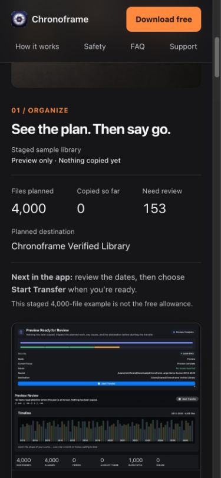
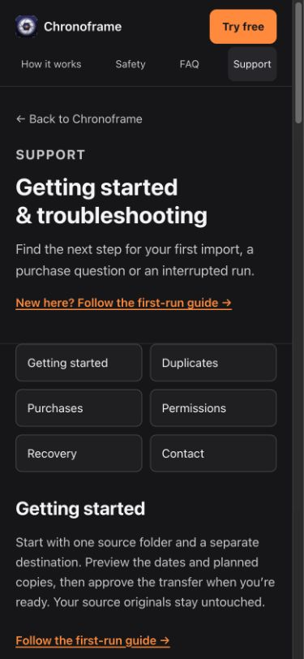
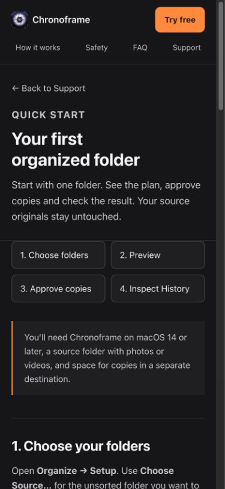
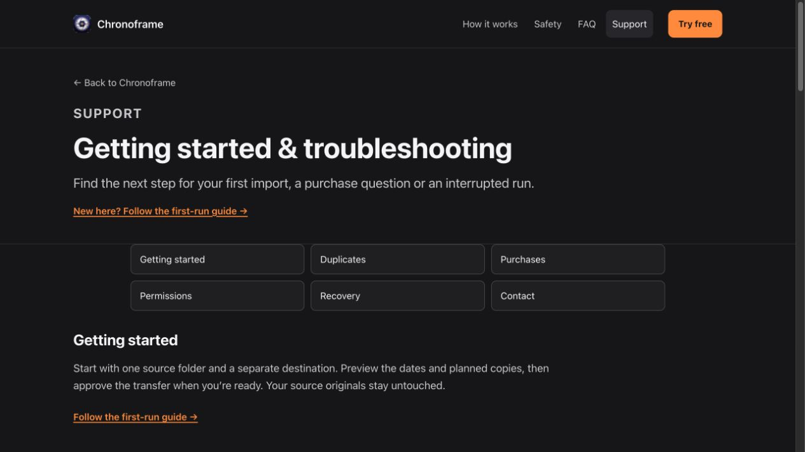

# Mobile preview and Support — October 18, 2026

> **Status (2026-11-21): historical record, shipped.** W1 (mobile preview) and W3 (Support) merged as PR #249 (`8c6948c`), based on #248 (`c6546b7`). W2 (public app/offer and refreshed or identified product proof) was deferred until public release; V2 has been public since 2026-10-22 and W2 is still open (see the open item in [website-design-2026-10-18.md](website-design-2026-10-18.md)). Shortened 2026-11-21: validation narrative condensed.

No app source, submitted build, hosting, dependencies or data collection changed.

## Implementation

- The homepage exposes a readable HTML summary before its image: 4,000 planned,
  zero copied, 153 needing review, the staged destination and the next app action.
  Sample scope is explicitly distinct from the free allowance. At up to 720px,
  CSS crops the unchanged 1920×1059 JPEG to x=630, y=95, width=850, height=660.
  This shows the real preview panel, timeline and counts. At the observed
  390px viewport, the image is about 259px tall instead of about 633px. The
  full original remains linked from both the image and its caption; development
  provenance and unknown capture build fields are preserved.
- Support has six topic shortcuts with focusable heading targets. Native
  disclosures answer common duplicate, purchase, permission and recovery problems.
  On-site answers retain the source-original, content-verification and conditional
  Revert guarantees. Existing `#purchases` links continue to work. A native email
  link supplies blank diagnostic labels only; the site sends no email or telemetry.
- New `quick-start.html` explains choosing separate folders, preview/review,
  approving verified copies and checking History. It draws from the committed
  public Quick Start/FAQ/Troubleshooting guidance and links to recovery help.
  Homepage, FAQ and Support point to it; deeper GitHub references remain optional.
  Existing unpublished `site/guides/` work in the primary checkout is preserved.
- Sitemap, required-page validation, keyboard full-size-image check and shared
  stylesheet cache version include the new page/presentation. The existing
  publication gate and owner-approved early-publication decision are preserved.

## Validation

- `python3 script/check_site.py --release` passed all ten HTML files, local links and fragments, sitemap, metadata, proof checksums, captions/media and the owner-approved prelaunch gate; four `test_site_release_gate.py` regressions, JavaScript syntax and `git diff --check` passed.
- Browser review at mobile 390×844 and desktop 1280×720: crop, readable summary, Support topics and guide inspected; Enter opens the full-size JPEG, all six Support shortcuts and four guide steps focus their headings, a troubleshooting disclosure expands, the purchase heading clears the sticky navigation, and the mailto URI was inspected without sending email.
- Axe-core 4.10.3 (WCAG 2 A/AA, 2.1 A/AA, 2.2 AA, best practices): zero violations and no document-wide overflow in 40 page/size runs (eight content pages at 320/390/768/1280, and at 320 with doubled font sizes; not a browser-zoom test). Some contrast checks stayed "incomplete" on existing gradient/decorative contexts and the homepage caption and note; these are not certified passes. New secondary ink `#c7c7cc` has at least 8.8:1 contrast on the relevant solid surfaces. Raw results: [the QA record](website-mobile-support-qa-2026-10-18.json).

This is focused browser, keyboard and automated QA, not WCAG certification. Spoken VoiceOver, physical iPhone/Safari, production StoreKit and public V2 capture-build mapping were not exercised. The film/player code is unchanged.

## Review captures

