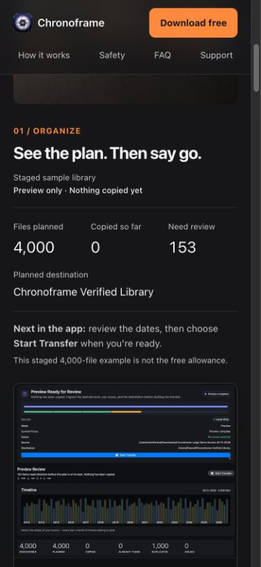
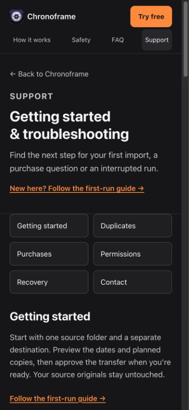
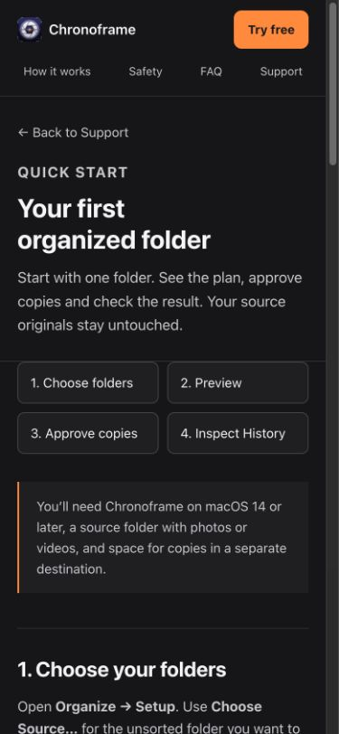
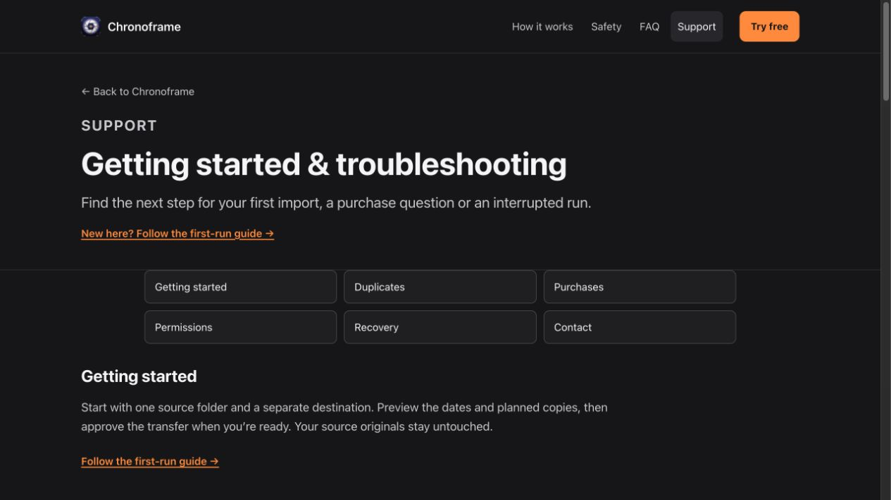

# Mobile preview and Support — October 18, 2026

The owner requested both recommendations from the live website follow-up review.
W1 (mobile preview) and W3 (Support) are implemented on
`codex/mobile-preview-support`, based on merged PR #248 (`c6546b7`). Publication
waits for the owner’s merge and Pages deployment. No app source, submitted build,
new hosting, dependencies or data collection changes are included.

## Implementation

- The homepage exposes a readable HTML summary before its image: 4,000 planned,
  zero copied, 153 needing review, the staged destination and the next app action.
  Sample scope is explicitly distinct from the free allowance. At up to 720px,
  CSS crops the unchanged 1920×1059 JPEG to x=630, y=95, width=850, height=660.
  This shows the real preview panel, timeline and counts. At the observed
  390px viewport, the image is about 259px tall instead of about 633px. The
  full original remains linked from both the image and its caption; development
  provenance and unknown capture build fields are preserved.
- Support has six topic shortcuts with focusable heading targets. Native
  disclosures answer common duplicate, purchase, permission and recovery problems.
  On-site answers retain the source-original, content-verification and conditional
  Revert guarantees. Existing `#purchases` links continue to work. A native email
  link supplies blank diagnostic labels only; the site sends no email or telemetry.
- New `quick-start.html` explains choosing separate folders, preview/review,
  approving verified copies and checking History. It draws from the committed
  public Quick Start/FAQ/Troubleshooting guidance and links to recovery help.
  Homepage, FAQ and Support point to it; deeper GitHub references remain optional.
  Existing unpublished `site/guides/` work in the primary checkout is preserved.
- Sitemap, required-page validation, keyboard full-size-image check and shared
  stylesheet cache version include the new page/presentation. The existing
  publication gate and owner-approved early-publication decision are preserved.

## Validation

- `python3 script/check_site.py --release`: passes all ten HTML files, local
  links/fragments, sitemap, metadata, proof checksums, captions/media and the
  owner-approved prelaunch gate. Four `test_site_release_gate.py` regressions pass.
  JavaScript syntax and `git diff --check` pass.
- Browser review: mobile 390×844 (375px document client width with scrollbar) and
  desktop 1280×720 (1265px client width). Screenshot crop, readable summary,
  Support topics and guide were visually inspected. Enter opens the full-size
  JPEG, all six Support shortcuts and all four guide steps focus their headings,
  and a troubleshooting disclosure expands. The purchase heading lands below
  the sticky navigation. The mailto URI was inspected without sending email.
- Axe-core 4.10.3, WCAG 2 A/AA, 2.1 A/AA, 2.2 AA and best-practice tags:
  **zero violations and no document-wide overflow in 40 page/size runs** — eight
  content pages at 320/390/768/1280 frame widths and at 320 with doubled computed
  font sizes. Scrollbars reduce recorded client widths by 15px on scrolling
  frames. All disclosures were expanded during checks. This font-size stress
  test is not a browser-zoom test.
- Axe reports some contrast checks as incomplete on the existing gradient/decorative
  contexts and homepage caption/note; these are not certified passes. The new
  secondary ink `#c7c7cc` has at least 8.8:1 contrast across the relevant solid
  canvas/panel surfaces. Support and the guide have zero incomplete results at
  all tested sizes. Raw node/results data is in
  [the QA record](website-mobile-support-qa-2026-10-18.json).

This is focused browser, keyboard and automated QA, not full WCAG certification.
Spoken VoiceOver, physical iPhone/Safari, production StoreKit and public V2
capture-build mapping were not exercised. The film/player code is unchanged.
W2 (public app/offer and refreshed or identified product proof) remains pending
until the public release; it is not a website publication hold.

## Review captures

